# Manual: Performance Quality Gate

Guía paso a paso, con capturas reales, para entender, usar y mostrar la herramienta.

**Herramienta:** https://github.com/LeoR22/perf-quality-gate  
**Repo del equipo que la usa:** https://github.com/LeoR22/perf-gate-demo

---

## Índice

1. [Qué es y cómo está organizado](#1-qué-es-y-cómo-está-organizado)
2. [El repo de la herramienta](#2-el-repo-de-la-herramienta)
3. [Los pipelines automáticos de la herramienta](#3-los-pipelines-automáticos-de-la-herramienta)
4. [El pipeline del equipo: A en rojo, B en verde](#4-el-pipeline-del-equipo-a-en-rojo-b-en-verde)
5. [El reporte: por qué no pasa y qué mejorar](#5-el-reporte-por-qué-no-pasa-y-qué-mejorar)
6. [Los límites de cada equipo (perf-gate.yml)](#6-los-límites-de-cada-equipo-perf-gateyml)
7. [El reporte visual en GitHub Pages](#7-el-reporte-visual-en-github-pages)
8. [Versiones: el único paso manual](#8-versiones-el-único-paso-manual)
9. [Ejecutarlo en tu computador](#9-ejecutarlo-en-tu-computador)
10. [Ejercicio: cambiar una regla y ver el pipeline reaccionar](#10-ejercicio-cambiar-una-regla-y-ver-el-pipeline-reaccionar)
11. [Cómo leer la tabla de resultados](#11-cómo-leer-la-tabla-de-resultados)
12. [Problemas comunes](#12-problemas-comunes)

---

## 1. Qué es y cómo está organizado

El **Performance Quality Gate** compara la prueba de carga de una **versión nueva** contra la de
**producción** y decide si puede desplegarse. Si no pasa, deja el pipeline en rojo, explica **por qué** y
**qué mejorar**.

**Resultado del reto:** la **versión B** reemplaza a producción. La **versión A no pasa**, porque `POST /pagos`
tarda 2,2 veces más (767 ms contra 353 ms) y su tasa de error sube de 0,25 % a 3,33 %.

Hay **dos repositorios**, como en la vida real:

| Repo | Rol | Qué contiene |
|---|---|---|
| `perf-quality-gate` | **La herramienta** | El código, los tests y la GitHub Action que otros equipos usan |
| `perf-gate-demo` | **Un equipo que la usa** | Sus resultados de carga, sus límites y su pipeline, que llama a `LeoR22/perf-quality-gate@v1` |

**Todo es automático**, salvo el paso de versión:

```
push o PR ──► tests + integración + gate de A y B        (automático)
tag v1.x.y ──► release inmutable                          (automático)
"Promover tag mayor" ──► mueve v1 a la versión nueva      (MANUAL)
perf-gate-demo usa @v1 ──► gate A/B + reporte + issue (automático)
```

---

## 2. El repo de la herramienta

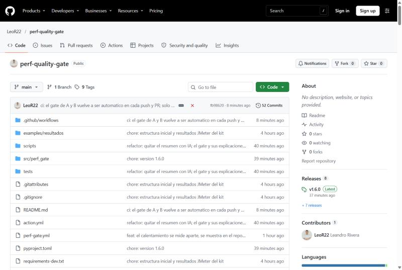

| Carpeta o archivo | Qué es |
|---|---|
| `src/perf_gate/` | El código de la herramienta (Python) |
| `tests/` | Pruebas automáticas (86) |
| `examples/resultados/` | Los CSV del reto: producción, A y B |
| `action.yml` | La definición de la GitHub Action |
| `perf-gate.yml` | Ejemplo de configuración de límites |
| `.github/workflows/` | Los pipelines (sección 3) |
| `README.md` | Documentación completa y el veredicto del reto |

A la derecha, en **Releases**, está la última versión publicada (v1.6.0).

---

## 3. Los pipelines automáticos de la herramienta

Entra a la pestaña **Actions**. A la izquierda están los 4 workflows:

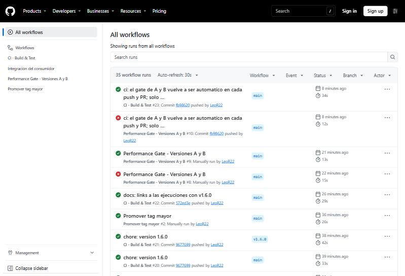

| Workflow | Cuándo corre | Qué hace |
|---|---|---|
| **CI - Build & Test** | Solo, en cada push y PR | Tests, verificación del README e integración del consumidor. Con un tag nuevo, publica la release |
| **Integración del consumidor** | Lo llama el CI | Usa la action como un equipo real y comprueba tres cosas: **A da FAIL, B pasa y un dato inválido bloquea** |
| **Performance Gate - Versiones A y B** | Solo, en cada push y PR | Evalúa A y B con la action de ese mismo commit |
| **Promover tag mayor** | **Manual** | El único paso manual (sección 8) |

### El CI (verde = la herramienta está sana)

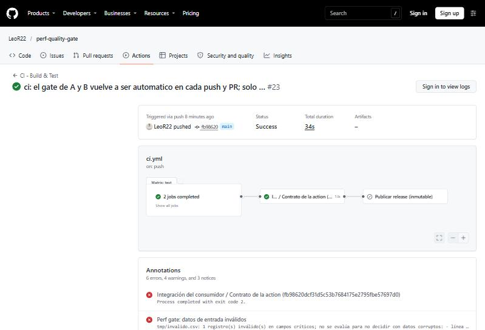

Se ven tres etapas: **tests** (Python 3.10 y 3.12), **Integración del consumidor** y **Publicar release**.
Esta última se omite si no hay un tag nuevo.

> **¿Por qué aparecen errores en "Annotations" si todo está en verde?** Son los casos de prueba **a propósito**.
> La integración alimenta la action con un archivo que tiene `success = "tru"` para verificar que **bloquee**
> (exit 2). Que aparezca ese error es la prueba de que funciona.

### El gate de A y B en la herramienta

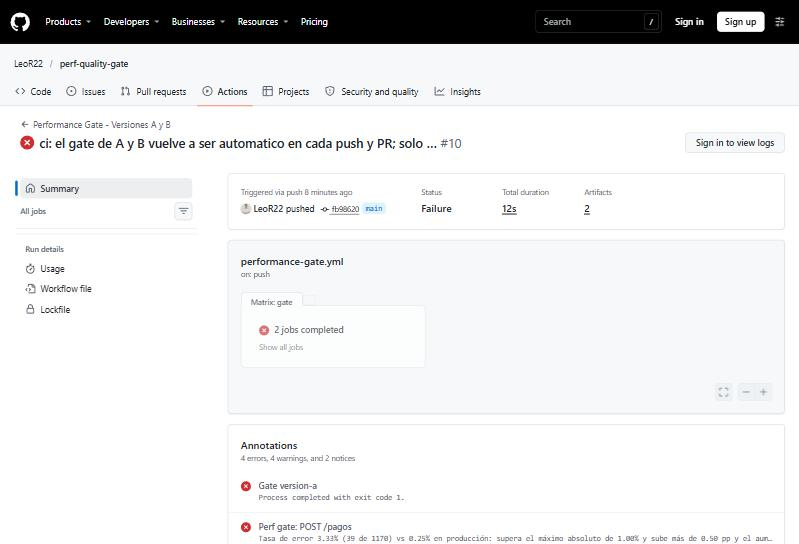

La ejecución completa sale **en rojo porque A no pasa**, y eso es correcto: el reto pide *"dejar el pipeline
en rojo cuando la versión no pasa"*. En "Annotations" ya aparece el motivo: `POST /pagos`.

---

## 4. El pipeline del equipo: A en rojo, B en verde

Este es el uso real: **perf-gate-demo** usa la herramienta como cualquier equipo del banco.

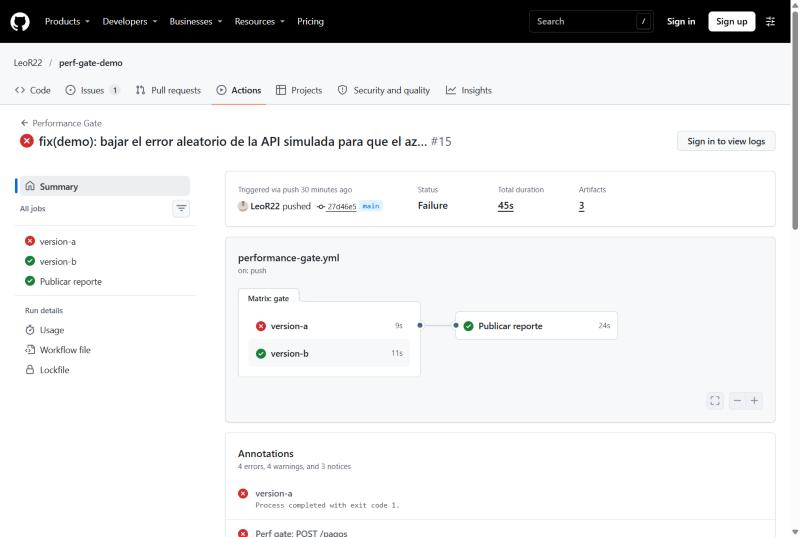

- ❌ **version-a**: el gate la bloquea.
- ✅ **version-b**: pasa.
- ✅ **Publicar reporte**: publica el reporte visual en GitHub Pages (sección 7), aunque A falle.

### El gate protege producción

Si abres el job **version-a**:

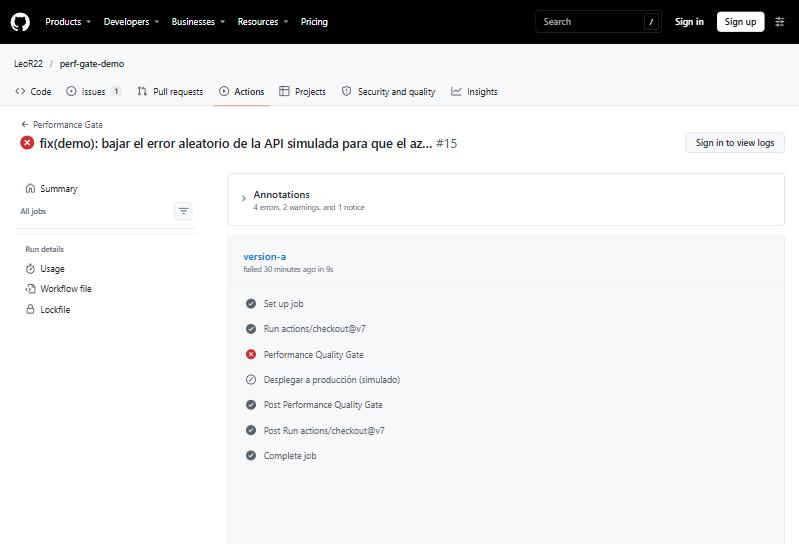

- **Performance Quality Gate** ❌: la versión no pasa.
- **Desplegar a producción (simulado)** ⊘: **se omitió**. El gate impidió el despliegue.

En el job **version-b**, los dos pasos salen en verde y el despliegue se ejecuta.


### Evaluar una versión nueva en el pipeline

No hay que tocar el workflow. **Cada archivo de `resultados/` del repo del equipo, salvo `produccion-actual.csv`,
se evalúa automáticamente** contra producción, con su propio job, reporte e issue:

1. En https://github.com/LeoR22/perf-gate-demo/tree/main/resultados → **Add file → Upload files**.
2. Sube el archivo, por ejemplo `version-c.csv`, y haz clic en **Commit changes**.
3. En **Actions** aparece la ejecución sola, con un job nuevo llamado `version-c`.

Para evaluar solo una: **Actions → Performance Gate → Run workflow** y escribir el nombre sin extensión.

---

## 5. El reporte: por qué no pasa y qué mejorar

Cada job tiene un **Summary** con el reporte (hay que iniciar sesión en GitHub para verlo). El mismo
reporte queda en el **issue** que la herramienta abre sola cuando una versión no pasa:

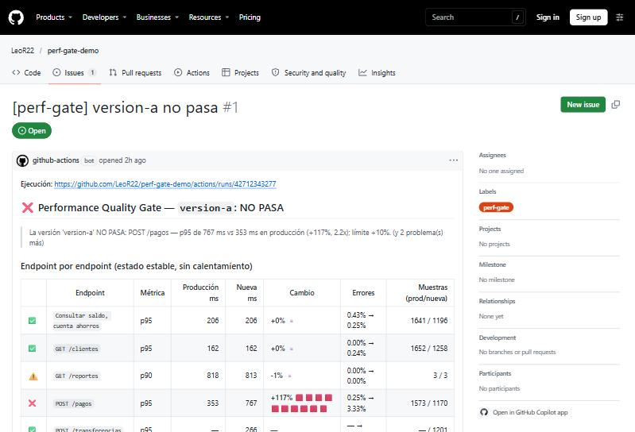

La tabla compara **endpoint por endpoint** contra producción. Solo pagos tiene ❌: pasa de 353 a 767 ms (+117 %).

Más abajo, el **porqué** y el **qué mejorar**:

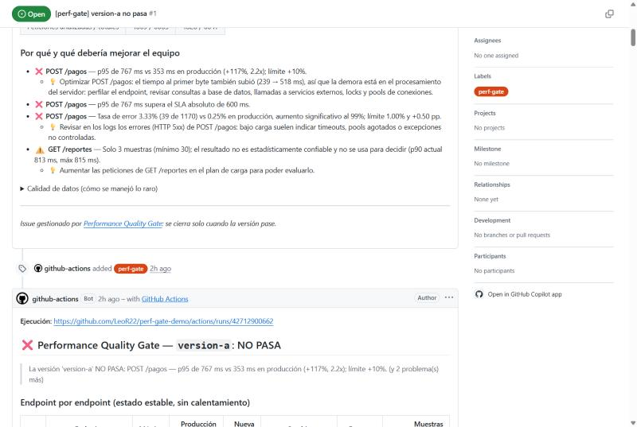

- ❌ El p95 de pagos subió 117 %. 💡 El tiempo al primer byte también subió (239 → 518 ms), así que el
  problema está **en el servidor** (base de datos, servicios externos, locks).
- ❌ Supera el SLA de 600 ms.
- ❌ La tasa de error sube a 3,33 % y la herramienta indica que el aumento es **estadísticamente significativo**.
- ⚠️ `GET /reportes` tiene solo 3 muestras: no alcanza para decidir.

El issue **se comenta en cada nueva ejecución** (sin duplicarse) y **se cierra solo** cuando la versión pase.

---

## 6. Los límites de cada equipo (perf-gate.yml)

Cada equipo ajusta sus reglas **sin tocar código**, en el archivo `perf-gate.yml` de su repo:

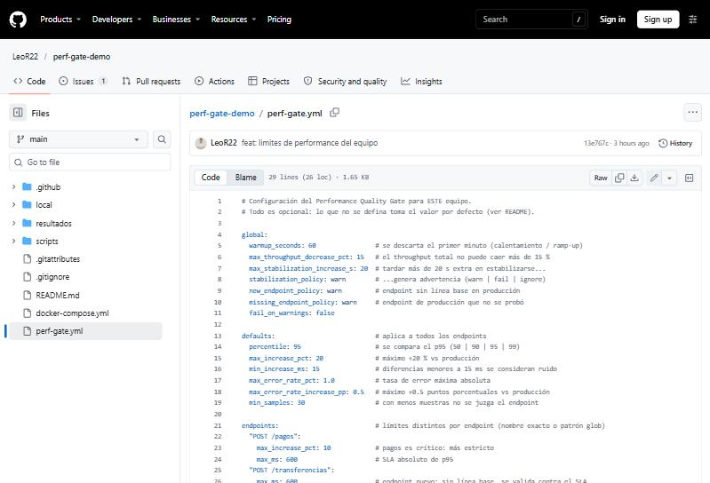

| Sección | Qué controla | Ejemplo |
|---|---|---|
| `global` | Reglas generales | 60 s de calentamiento; el throughput no puede caer más de 15 % |
| `defaults` | Lo que aplica a todos los endpoints | Se compara el p95; máximo +20 %; error máximo 1 % |
| `endpoints` | Límites por endpoint | Pagos: máximo +10 % y SLA de 600 ms |

Un valor mal escrito (por ejemplo `max_increase_pct: veinte`) **detiene el pipeline con un error claro**
(exit 2), para que un error de tipeo nunca desactive un límite sin que nadie lo note.

---

## 7. El reporte visual en GitHub Pages

En cada ejecución del equipo se publica un sitio con los reportes: https://leor22.github.io/perf-gate-demo/

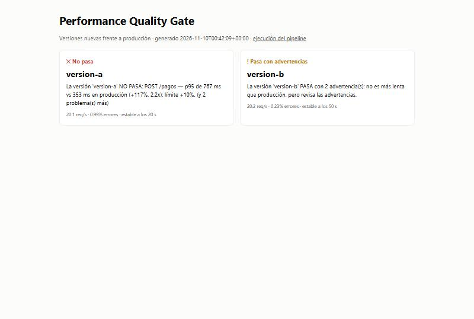

Al hacer clic en una versión se abre su reporte completo. **Versión A:**

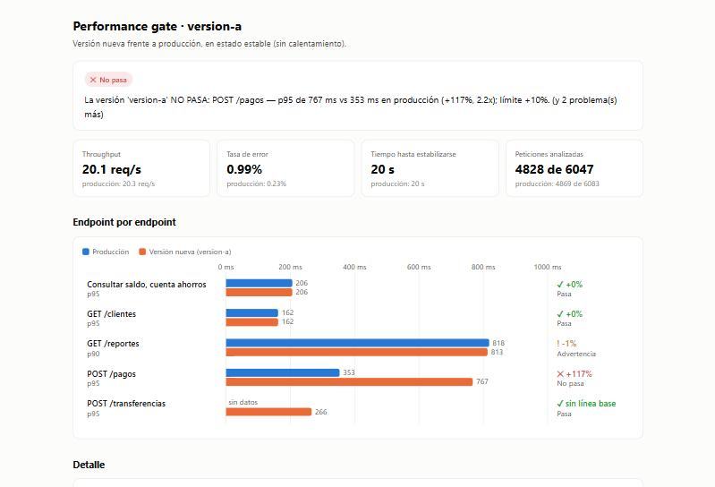

- Arriba, el **veredicto** y las tarjetas de throughput, errores, estabilización y peticiones analizadas.
- El **gráfico** compara por endpoint: azul = producción, naranja = versión nueva. La barra de pagos es la
  que salta a la vista.

Más abajo, el **detalle** y el **arranque (calentamiento)**:

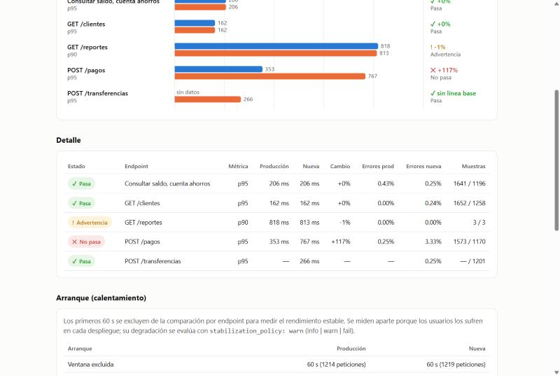

**Versión B:** pasa, pero el reporte muestra su arranque lento (50 s contra 20 s de producción):

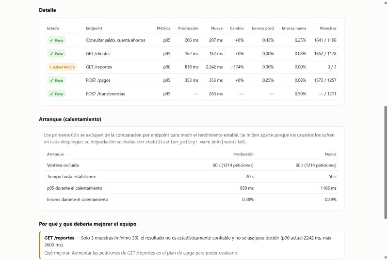

> **Por qué se excluyen los primeros 60 s:** si se compara el archivo completo, B *parece* peor por su arranque.
> Una vez estable, rinde igual que producción. El arranque no se ignora: se mide aparte y genera una advertencia.

---

## 8. Versiones: el único paso manual

Cada versión publicada es **inmutable**:

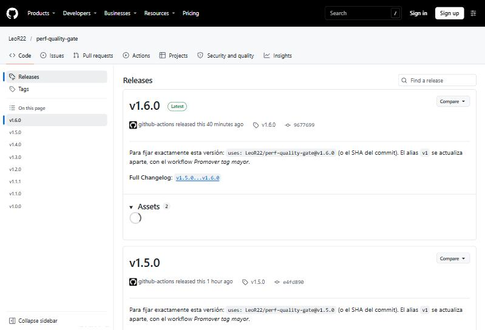

Los equipos usan `@v1`, que apunta a la última versión **promovida**. Para moverlo se usa
**Promover tag mayor**, que antes de mover `v1` vuelve a correr la integración del consumidor:

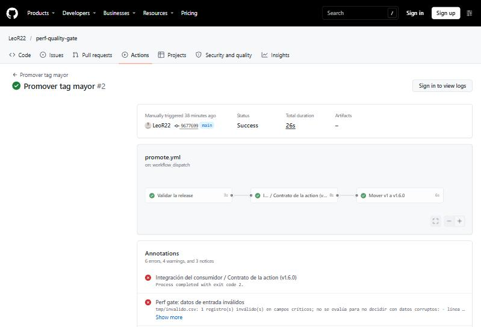

**Cómo ejecutarlo** (requiere iniciar sesión en GitHub):
1. Ve a https://github.com/LeoR22/perf-quality-gate/actions/workflows/promote.yml
2. Haz clic en el botón verde **Run workflow** (arriba a la derecha).
3. Deja `Branch: main` y escribe la versión, por ejemplo `v1.6.0`.
4. Haz clic en **Run workflow** dentro del panel.
5. Recarga la página: aparece la ejecución con tres etapas en verde: **Validar la release → Contrato de
   la action → Mover v1**.

---

## 9. Ejecutarlo en tu computador

Todo corre **en tu PC**: no se conecta a GitHub ni dispara ningún pipeline. Abre **PowerShell**:

**1. Descargar el repositorio**
```powershell
cd C:\Prueba_tecnica
git clone https://github.com/LeoR22/perf-quality-gate.git perf-quality-gate-local
cd perf-quality-gate-local
```

**2. Crear un entorno aislado e instalar**
```powershell
python -m venv .venv
.\.venv\Scripts\Activate.ps1
python -m pip install .
```

**3. Evaluar la versión A**
```powershell
python -m perf_gate --baseline examples/resultados/produccion-actual.csv --candidate examples/resultados/version-a.csv --config perf-gate.yml --name version-a --report-dir reporte-a
```

Salida real (resumida; la completa está en [`salidas/salida-version-a.txt`](salidas/salida-version-a.txt)):
```
❌  PERFORMANCE QUALITY GATE — FAIL
La versión 'version-a' NO PASA: POST /pagos — p95 de 767 ms vs 353 ms en producción (+117%, 2.2x); límite +10%.
Endpoint                             p  Prod ms  Nueva ms  Cambio       Err %  Estado
Consultar saldo, cuenta ahorros     95      206       206     +0%     0.4→0.3  PASS
GET /clientes                       95      162       162     +0%     0.0→0.2  PASS
GET /reportes                       90      818       813     -1%     0.0→0.0  WARN
POST /pagos                         95      353       767   +117%     0.3→3.3  FAIL
POST /transferencias                95        —       266       —        →0.2  PASS
...
exit A = 1
```

**4. Evaluar la versión B**
```powershell
python -m perf_gate --baseline examples/resultados/produccion-actual.csv --candidate examples/resultados/version-b.csv --config perf-gate.yml --name version-b --report-dir reporte-b
```
Muestra **⚠️ PASA con advertencias** y `exit B = 0` ([salida completa](salidas/salida-version-b.txt)).

**5. Abrir el reporte en el navegador**
```powershell
start reporte-b\report.html
```

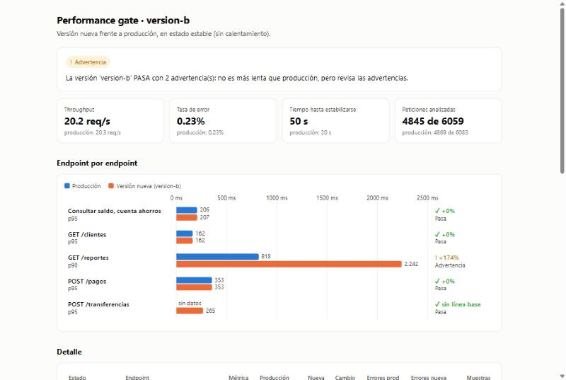

Es el mismo reporte que publica GitHub Pages, generado en tu computador.

**6. Código de salida** (lo que pone el pipeline en rojo o verde):
```powershell
echo $LASTEXITCODE
```
`1` = no pasa (bloquea) · `0` = pasa · `2` = datos o configuración inválidos (también bloquea).

**7. Tests (opcional)**
```powershell
python -m pip install pytest
python -m pytest -q
```
Resultado esperado: `86 passed`.

**8. Salir del entorno**
```powershell
deactivate
```

> ⚠️ En este equipo usa siempre `python -m perf_gate` y **no** `perf-gate`: Windows bloquea el `perf-gate.exe`
> que crea pip (Control de aplicaciones). `python -m perf_gate` hace exactamente lo mismo.

### Evaluar otro archivo

Copia tu archivo a la carpeta y cámbialo en `--candidate`:
```powershell
python -m perf_gate --baseline examples/resultados/produccion-actual.csv --candidate mi-version.csv --config perf-gate.yml --name mi-version --report-dir reporte-mi-version
start reporte-mi-version
eport.html
```

Se puede comparar cualquier archivo contra cualquier otro (`--baseline` es la referencia):

| Qué quieres ver | `--baseline` | `--candidate` | Resultado esperado |
|---|---|---|---|
| Producción contra sí misma | `produccion-actual.csv` | `produccion-actual.csv` | ✅ PASA |
| ¿B es mejor que A? | `version-a.csv` | `version-b.csv` | ✅ pagos −54 % |

**Requisitos:** columnas `timeStamp`, `elapsed`, `label` y `success` (`true`/`false`); los `label` deben
coincidir con los de producción. Un dato inválido detiene la evaluación indicando la línea y la columna.

---

## 10. Ejercicio: cambiar una regla y ver el pipeline reaccionar

Demuestra el flujo automático completo (requiere sesión en GitHub):

1. Abre https://github.com/LeoR22/perf-gate-demo/blob/main/perf-gate.yml
2. Haz clic en el **lápiz ✏️** (Edit this file).
3. Cambia `stabilization_policy: warn` por `stabilization_policy: fail`.
4. Haz clic en **Commit changes…** y luego otra vez en **Commit changes**.
5. Ve a https://github.com/LeoR22/perf-gate-demo/actions. Aparece una ejecución **nueva que nadie lanzó
   a mano**: la disparó tu commit.
6. Después de más o menos un minuto, **B también falla** por su arranque lento, y su despliegue se bloquea.
7. **Vuelve a dejarlo en `warn`** (repite los pasos 1 a 4) para que B vuelva a pasar.

---

## 11. Cómo leer la tabla de resultados

Ejemplo: `❌ p95 767 (+117%) · 3.33% · n=1170` (pagos, versión A)

| Parte | Significado | Cálculo |
|---|---|---|
| **p95 767** | El 95 % de las peticiones respondió en 767 ms o menos | Se ordenan los tiempos y se toma el del puesto 95 % |
| **+117%** | Cuánto empeoró frente a producción | (767 − 353) ÷ 353 = +117 % |
| **3.33%** | Porcentaje de peticiones fallidas | 39 ÷ 1170 |
| **n=1170** | Peticiones analizadas (sin el calentamiento) | — |

- **❌** bloquea · **⚠️** advertencia (no bloquea) · **✅** pasa.
- `GET /reportes` usa **p90** porque así lo configuró el equipo, y no decide nada porque tiene solo 3 muestras.
- `POST /transferencias` dice **"sin línea base"** porque no existe en producción: se valida contra un SLA fijo.
- **Throughput** = peticiones por segundo que atiende el sistema (unas 20 en las tres pruebas).

---

## 12. Problemas comunes

| Situación | Explicación |
|---|---|
| Toda la ejecución sale en rojo | Es correcto: la versión A no pasa. Abre la ejecución: B está en verde |
| No veo el "Summary" del job | GitHub lo muestra solo con la sesión iniciada. El mismo reporte está en el issue y en Pages |
| `perf-gate.exe` bloqueado en Windows | Usa `python -m perf_gate` (sección 9) |
| Errores en "Annotations" del CI aunque esté en verde | Son los casos de prueba intencionales de la integración (sección 3) |
| Hice un cambio local y no pasó nada en GitHub | Lo local no se conecta a GitHub. Solo un `git push` dispara los pipelines |
